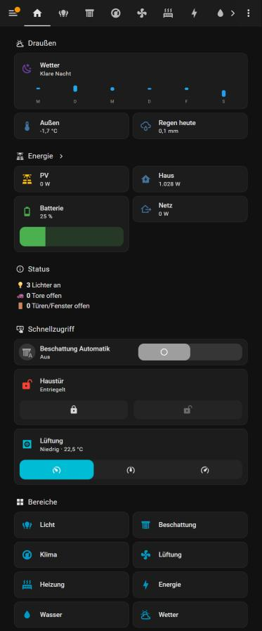

# Haus-Kategorien (Dashboard-Strategie)

Dashboard-Strategie für Home Assistant: Kategorien zuerst, darunter Etagen und Räume.



*Startseite des erzeugten Dashboards (Handy-Ansicht).*

Erzeugt ein komplettes Dashboard: Startseite, Kategorien (Licht, Beschattung, Klima, Heizung, Energie, Medien …)
und darunter Etagen und Räume. Nutzt die übrigen Karten dieser Sammlung, wenn sie installiert sind
(z. B. `puffer-karte`, `kessel-karte`, `fernseher-karte`, `energie-heute-karte`); fehlt eine, wird eine Standardkarte verwendet.

### Grafischer Editor

Ab v1.1.0 lassen sich alle Einstellungen ohne YAML bearbeiten: Dashboard öffnen → ✏️ **Bearbeiten**. Das Formular ist in
aufklappbare Abschnitte gegliedert (Allgemein, Wetter, Energie, Licht & Beschattung, Lüftung, Wasser, Heizung, Sicherheit,
Medien, Service-Dashboard, Reihenfolge) und bietet Entity-, Bereichs- und Etagen-Auswahl. Listen wie Pufferspeicher, Heizkreise,
Radios oder Fernseher werden mit Hinzufügen/Bearbeiten/Entfernen gepflegt. Das funktioniert auch in verschachtelten Listen
(z. B. Apps und Sender je Fernseher).

Der Editor schreibt dieselbe Konfiguration wie bisher unter `strategy:`. Bestehende YAML-Dashboards funktionieren also
unverändert. Leere Felder werden beim Speichern entfernt, unbekannte Schlüssel bleiben erhalten. Bei älteren Home-Assistant-Versionen
ohne Objekt-Selektor mit Feldern erscheinen die Listen als YAML-Feld im Formular.

### Einstellungen

Alle Einstellungen stehen in der Dashboard-Konfiguration unter `strategy:` und werden dort auch vom grafischen Editor gespeichert.
Der Code enthält keine Vorbelegung. Fehlende Einträge werden übersprungen.

| Schlüssel | Art |
|---|---|
| `etagen` | Liste |
| `wetter` | Text / Entity-ID |
| `aussen_temp` | Text / Entity-ID |
| `regen_heute` | Text / Entity-ID |
| `aussen_feuchte` | Text / Entity-ID |
| `luftdruck` | Text / Entity-ID |
| `wind_richtung` | Text / Entity-ID |
| `wind_geschwindigkeit` | Text / Entity-ID |
| `wind_boee` | Text / Entity-ID |
| `regen_gesamt` | Text / Entity-ID |
| `pv` | Text / Entity-ID |
| `haus` | Text / Entity-ID |
| `haus_aufteilung` | Liste |
| `batterie` | Text / Entity-ID |
| `batterie_leistung` | Text / Entity-ID |
| `netz` | Text / Entity-ID |
| `pv_heute` | Text / Entity-ID |
| `bezug_heute` | Text / Entity-ID |
| `einspeisung_heute` | Text / Entity-ID |
| `haustuer` | Text / Entity-ID |
| `lueftung` | Text / Entity-ID |
| `stosslueften` | Text / Entity-ID |
| `stosslueften_timer` | Text / Entity-ID |
| `filter_reset` | Text / Entity-ID |
| `lueftung_bild` | Text / Entity-ID |
| `ueberhitzungsschutz` | Text / Entity-ID |
| `automatik_alle` | Text / Entity-ID |
| `service_prefix` | Text / Entity-ID |
| `wasser_zaehler` | Text / Entity-ID |
| `wasser_tag` | Text / Entity-ID |
| `wasser_monat` | Text / Entity-ID |
| `wasser_teich` | Text / Entity-ID |
| `heizung_raum` | Text / Entity-ID |
| `schnecken_leistung` | Text / Entity-ID |
| `schnecken_verbrauch` | Text / Entity-ID |
| `schnecken_tag` | Text / Entity-ID |
| `schnecken_monat` | Text / Entity-ID |
| `puffer` | Liste |
| `waermemenge` | Liste |
| `kessel` | Objekt |
| `heizkreise` | Liste |
| `alarm` | Text / Entity-ID |
| `service` | Objekt |
| `receiver` | Objekt |
| `sat` | Objekt |
| `radio` | Liste |
| `fernseher` | Liste |
| `heizung_geraete` | Liste |
| `energie` | Objekt |
| `licht_leistung` | Text: Muster für den Leistungssensor je Lampe, `{objekt}` = Objekt-ID der Lampe (z. B. `sensor.licht_{objekt}_leistung`). Die Leistung erscheint als Badge in der Raum-Überschrift, solange die Lampe Strom braucht. |
| `beschattung_leistung` | Text: Muster für den Leistungssensor je Behang, `{objekt}` = Objekt-ID des Behangs (z. B. `sensor.beschattung_{objekt}_leistung`). Die Leistung erscheint als Badge in der Raum-Überschrift, solange der Behang fährt. |

Beispiel (Ausschnitt):

```yaml
strategy:
  type: custom:haus-kategorien
  etagen: [eg, og, keller]
  wetter: weather.forecast_home
  aussen_temp: sensor.aussentemperatur
  heizung_raum: heizraum
  puffer:
    - titel: Puffer
      oben: sensor.puffer_temperatur_oben
      unten: sensor.puffer_temperatur_unten
  energie:
    pv: sensor.pv_energie_heute
    bezug: sensor.netzbezug_heute
    einspeisung: sensor.einspeisung_heute
    batterie_kwh: 10
```

## Installation

### Über den Marketplace (Home Assistant 2026.11 und neuer)

1. **Einstellungen** → **Marketplace** → **Aus Link hinzufügen**.
2. Die Adresse dieses Repositorys eintragen, Kategorie **Dashboard**.
3. **Haus-Kategorien (Dashboard-Strategie)** installieren. Die Ressource wird dabei automatisch eingetragen.

### Über HACS (ältere Versionen)

**HACS** → ⋮ → **Benutzerdefinierte Repositories** → Adresse dieses Repositorys, Typ **Dashboard** → installieren.

### Manuell

`haus-kategorien.js` nach `/config/www/` kopieren und unter **Einstellungen** → **Dashboards** → ⋮ → **Ressourcen**
als JavaScript-Modul `/local/haus-kategorien.js` eintragen.

## Verwendung

```yaml
strategy:
  type: custom:haus-kategorien
  # weitere Einstellungen siehe unten
```

## Konfiguration

```
Siehe Abschnitt oben.
```

## Lizenz

MIT
